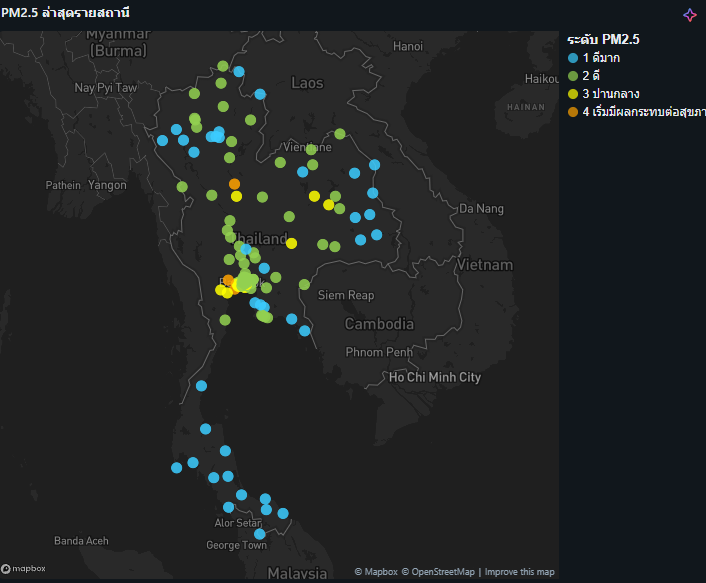
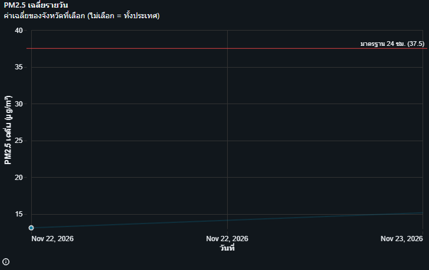
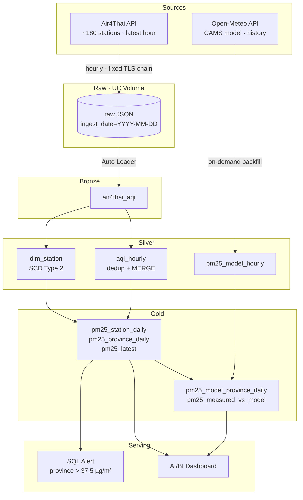
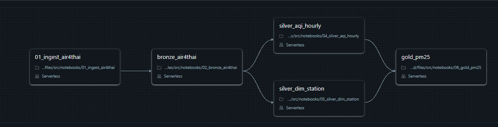
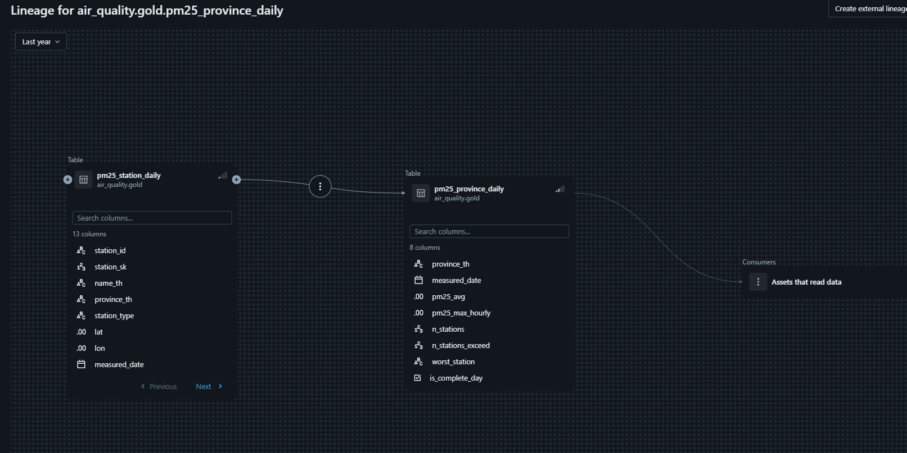

# Thailand PM2.5 Lakehouse on Databricks

[](https://github.com/stampnapat/thai-air-quality-lakehouse/actions/workflows/ci.yml)

An hourly, end-to-end data pipeline for air quality in Thailand. It pulls PM2.5 readings for about 180 government monitoring stations from the [Air4Thai](http://air4thai.pcd.go.th/) API (Pollution Control Department). Each run cleans the readings through a Bronze → Silver → Gold medallion architecture on Databricks, and the results feed a live dashboard with a map, trends and a province ranking.

Air4Thai only publishes the **latest** hour for each station, so history exists only if you collect it. This project polls the API every hour and keeps everything. It also backfills one year of history from a model, Open-Meteo/CAMS, kept in separate tables.

Everything is deployed as code with Databricks Asset Bundles and tested in GitHub Actions.

| Latest PM2.5 by station (Thai PCD colour bands) | Daily average vs the 24-hour standard |
|---|---|
|  |  |

*AI/BI dashboard on Databricks, refreshed by the hourly job. The trend covers the first days of live collection; the one-year model history is a separate chart.*

## Architecture



A Databricks Job runs the pipeline every hour at :15 (Bangkok time). It has 5 serverless tasks, and Gold waits for both Silver tasks:

```
01_ingest_air4thai → bronze_air4thai → silver_aqi_hourly  ─┐
                                     → silver_dim_station ─┴→ gold_pm25
```

## Tech stack

| Area | Used |
|---|---|
| Platform | Databricks Free Edition (serverless), Unity Catalog (catalogs, schemas, volumes, lineage) |
| Ingestion | Python `requests`, Auto Loader (`cloudFiles`), Structured Streaming `availableNow` |
| Storage | Delta Lake: `MERGE`, liquid clustering, identity columns, time travel, `SHALLOW CLONE` |
| Transform | PySpark (window functions, `foreachBatch`), Spark SQL (CTE, `QUALIFY`, `MAX_BY`, `COUNT_IF`) |
| Serving | AI/BI (Lakeview) dashboard, Databricks SQL alert |
| DevOps | Databricks Asset Bundles (dev/prod targets), pytest + local PySpark, GitHub Actions |

## Data model

| Layer | Table | Grain | Notes |
|---|---|---|---|
| Raw | `/Volumes/<catalog>/raw/landing/air4thai/` | 1 file per API call | Untouched JSON, partitioned by `ingest_date` |
| Bronze | `bronze.air4thai_aqi` | 1 row per station per file | Exploded `stations`, plus `_source_file`, `_ingested_at`, `_rescued_data` |
| Silver | `silver.aqi_hourly` | 1 row per station per measured hour | Typed values, `-1` → `NULL`, `is_stale`, `row_hash`, idempotent `MERGE` |
| Silver | `silver.dim_station` | 1 row per station version | **SCD Type 2**: `station_sk`, `valid_from`, `valid_to`, `is_current`, `attr_hash` |
| Gold | `gold.pm25_station_daily` | station × day | As-of join to the station version that was valid at measurement time; `is_complete_day` (≥ 18 h) |
| Gold | `gold.pm25_province_daily` | province × day | Average of station averages, stations over the standard, worst station |
| Gold | `gold.pm25_latest` | station | Latest reading, with Thai PCD colour band |
| Silver/Gold | `pm25_model_hourly`, `pm25_model_province_daily`, `pm25_measured_vs_model` | — | Model backfill, kept **separate** from measured data |

## Data quality findings

I profiled Bronze before writing Silver. These are the problems I found and how the pipeline handles each one:

| Finding | Evidence | Handling |
|---|---|---|
| **Stale stations repeat old readings** every hour | 6 stations whose last reading was weeks old (oldest 2026-10-09) | `fetch_lag_minutes` from the file timestamp; `is_stale` when > 180 min; excluded from Gold |
| **Duplicate readings** | 345 duplicate (station, hour) groups in the first 7 hourly files: stale stations plus manual re-runs | `ROW_NUMBER()` dedup keeping the first fetch, then `MERGE` on (station_id, measured_at) |
| **`-1` means missing** | Missing rate: PM2.5 0.6%, PM10 63.9%, O3 84.4%, CO 82.8% | Converted to `NULL`, never averaged as a number |
| **Bangkok stations have no province** in `areaTH` | e.g. "สวนลุมพินี เขตปทุมวัน" | Province rule: `stationType = BKK` → กรุงเทพฯ; otherwise last comma-separated part, with the "จ." prefix stripped |
| **Mobile stations move** | Station o64 relocates between deployments | SCD Type 2 dimension; Gold joins on the version valid *at measurement time* |
| **Station history starts after the first readings** | First dim version is created by the first pipeline run | The first version is treated as valid from 1900 (`effective_from`) so early readings still join |

From the first 8 hourly files, Bronze had 1,440 rows and Silver kept 1,002, with 0 duplicates remaining.

## Engineering notes

- **Broken TLS chain on the source API.** Air4Thai serves a Let's Encrypt certificate but sends the wrong intermediate certificates, so `requests` fails with `CERTIFICATE_VERIFY_FAILED`. Instead of disabling verification (`verify=False`), the ingest notebook downloads the missing Let's Encrypt intermediates and checks their **SHA-256 fingerprints**. It then appends them to the `certifi` bundle and passes that bundle to `verify=`.
- **Idempotent at every layer.** Auto Loader checkpoints, `availableNow` triggers, and `MERGE` with `row_hash`/`attr_hash` mean any task can be re-run with no duplicates and no needless updates.
- **Out-of-order safe SCD2.** The dimension `MERGE` uses the merge-key trick (`UNION ALL` of updates with a `NULL` key) and ignores versions older than the current one.
- **Auto Loader gotcha.** With `inferColumnTypes=false`, the nested `stations` array is inferred as a STRING and `explode` fails. The fix was to enable type inference (leaf values stay strings because Air4Thai quotes numbers) and reset the schema location.
- **Dev/prod isolation.** Every notebook reads a `catalog` job parameter. The `dev` bundle target writes to `air_quality_dev`, so testing never touches production tables.
- **Testable notebooks.** `tests/notebook_loader.py` parses a notebook with `ast` and runs only imports, constants and function definitions. The tests then call the real notebook functions on local PySpark without fetching the API or writing tables.

## Measured vs model

The Open-Meteo backfill comes from the CAMS model at about 45 km resolution, not from station measurements. `gold.pm25_measured_vs_model` compares the two on days that have both:

| Metric | Value |
|---|---|
| Station-days compared | _see `07_backfill_open_meteo` output_ |
| Mean bias (model − measured) | _µg/m³_ |
| Mean absolute error | _µg/m³_ |
| Correlation | _r_ |

The model history is useful for showing the **haze season** (Chiang Mai monthly average peaked around 54 µg/m³ in April 2026, versus about 10 in the rainy season). It is never mixed into measured tables.

## Repository layout

```
databricks.yml                 bundle: variables + dev/prod targets
resources/                     jobs, dashboard, alert (one resource per file)
src/notebooks/                 00_setup … 07_backfill_open_meteo
src/dashboards/                AI/BI dashboard definition (.lvdash.json)
src/demo/99_demo_scd2.py       SCD2 + time-travel demo (not scheduled)
tests/                         pytest suite (local PySpark)
.github/workflows/ci.yml       unit tests on every push/PR; bundle validate/deploy when secrets exist
```

## Run it yourself

1. Create a free [Databricks Free Edition](https://www.databricks.com/learn/free-edition) workspace and install the [Databricks CLI](https://docs.databricks.com/dev-tools/cli/).
2. Log in: `databricks auth login --host https://<your-workspace>.cloud.databricks.com`
3. Deploy and create the dev catalog:
   ```bash
   databricks bundle deploy -t dev
   databricks bundle run -t dev setup_catalog
   databricks bundle run -t dev air4thai_hourly
   databricks bundle run -t dev open_meteo_backfill   # optional history
   ```
4. Run the tests locally (needs Java 17+):
   ```bash
   pip install -r requirements-dev.txt
   pytest
   ```

To let CI deploy to `prod` on every push to `main`, add the repository secrets `DATABRICKS_HOST` and `DATABRICKS_TOKEN`.

<!-- Screenshots: add the images to docs/images/, then uncomment
## Screenshots

| | |
|---|---|
| Job DAG (5 tasks) |  |
| Unity Catalog lineage |  |
| SCD2 history for a moved station |  |
-->

## Limitations and next steps

- Station coverage depends on Air4Thai, which has about 180 stations and some long-stale sensors. Model data is coarse (~45 km), so many Bangkok stations share one grid cell.
- Gold tables are rebuilt in full every hour (`CREATE OR REPLACE`), which is fine at this size (thousands of rows a day). At larger scale they would become incremental `MERGE`s or materialized views.
- Possible next steps: weather features (wind, rain) for the haze season, a PM2.5 forecast with `ai_forecast`, and data-quality expectations with Spark Declarative Pipelines.

## Data sources and licence

- PM2.5 measurements: [Air4Thai](http://air4thai.pcd.go.th/), Pollution Control Department, Thailand.
- Modelled history: [Open-Meteo Air Quality API](https://open-meteo.com/en/docs/air-quality-api) (CAMS), CC BY 4.0.
